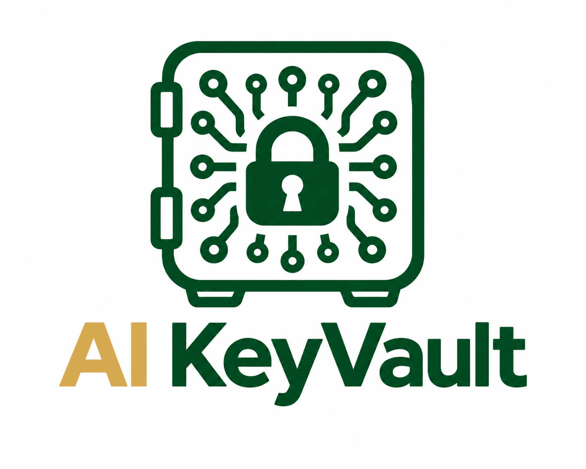

# AI KeyVault

<p align="center">
  
</p>

<p align="center">
  <strong>Bóveda y tablero personal para cuentas de agentes de IA de programación</strong><br/>
  Administra todas tus cuentas de Antigravity, Codex, Claude, Gemini, OpenCode y Grok desde un solo lugar.
</p>

---

## ⚖️ Alcance ético

**AI KeyVault es una herramienta personal.** Está diseñada para:

- Administrar **cuentas propias** del autor en **PCs propias**.
- No tiene fines comerciales ni de distribución de accesos.
- No evade bloqueos ni comparte cuentas con terceros.
- La rotación de cuentas, el ping mínimo y la automatización son decisiones configurables del usuario, con registro completo de cada acción.
- No extrae, roba ni expone credenciales de nadie más.

---

## ✨ Funcionalidades principales

| Funcionalidad | Descripción |
|---------------|-------------|
| 🔐 **Bóveda cifrada** | Correo, contraseña y tokens guardados con XChaCha20-Poly1305 |
| 📊 **Panel de cuota** | % usado por ventana, próximo reinicio, fuente y antigüedad de cada lectura |
| 🔄 **Cambio de cuenta** | La herramienta ejecuta el cambio en Credential Manager / auth.json — tú no corres scripts |
| 🔔 **Alertas inteligentes** | Notificación Windows + ntfy.sh al celular con sugerencia de cuenta alternativa |
| 💬 **Chats activos** | Metadatos de chats de todas tus PCs con la herramienta instalada |
| 📈 **Estadísticas** | Serie temporal propia: burn rate, proyección, mapa de calor, comparativa de cuentas |
| 🏓 **Ping mínimo** | Inicia el cooldown de la ventana con el menor consumo posible (manual por defecto) |
| 🖥️ **Multi-dispositivo** | Sincronización vía API propia en VPS, clave de cifrado nunca sale del cliente |

---

## 🏗️ Arquitectura

```
Cliente (Windows)          VPS (DigitalOcean)         GitHub
─────────────────          ──────────────────         ──────
App Tauri 2 (Rust+TS)  →  API Rust/axum + SQLite  ←  Actions (deploy)
Agente local (bg)          Caddy (TLS)                ai_keyvault_data
Caché DPAPI                                           (snapshots cifrados)
```

**Principio de conocimiento cero:** el servidor solo almacena texto cifrado. La clave que descifra nunca sale de tus PCs.

---

## 🚀 Instalación en una PC nueva

> **Prerequisitos:** Windows 10/11, conexión a internet.

1. Descarga el instalador desde [Releases](https://github.com/MiguelGotea/ai_keyvault/releases).
2. Ejecuta `AI_KeyVault_Setup_vX.X.X.exe`.
3. Al abrir por primera vez, ingresa:
   - **URL del servidor:** `https://keyvault.tudominio.com` (o la IP del VPS)
   - **Usuario:** tu usuario de AI KeyVault
   - **Clave maestra:** tu clave maestra personal
4. La bóveda se descarga y descifra localmente. Listo.

> Si es la primera PC, en lugar del paso 3 crearás la bóveda y recibirás tu **clave de respaldo** (guárdala en papel, offline).

---

## 🔒 Seguridad

- **Argon2id** como KDF (parámetros en `docs/adr/ADR-002-cifrado.md`).
- **XChaCha20-Poly1305** para cifrado autenticado.
- **DPAPI** de Windows para caché local rápida.
- **Ed25519** para autenticación de dispositivos con el servidor.
- Autobloqueo configurable (por defecto 15 min).
- Portapapeles limpiado automáticamente a los 30 s.
- Sin telemetría hacia terceros.
- `gitleaks` en CI — ningún secreto puede entrar al repo.

---

## 📂 Estructura del repositorio

```
ai_keyvault/
  apps/desktop/           # App Tauri 2 (UI + lógica de escritorio)
  crates/core/            # Bóveda, cifrado, sincronización (Rust)
  providers/              # Adaptadores: agy, codex, claude, gemini, opencode, grok
  server/                 # API del VPS (Rust/axum)
  agent/                  # Agente local Windows (segundo plano)
  docs/research/          # Investigación con evidencia
  docs/adr/               # Architecture Decision Records
  assets/branding/        # Logos e íconos
  .scripts/               # Herramientas de desarrollo
  .github/workflows/      # CI, escaneo de secretos, deploy, respaldo
```

---

## 🗺️ Fases de desarrollo

Ver [`PLAN.md`](PLAN.md) para el detalle completo.

| Fase | Estado | Contenido |
|------|--------|-----------|
| 0 | 🔄 En progreso | Investigación, ADRs, cooldown-logger |
| 1 | ⏳ Pendiente | Núcleo seguro: bóveda y cifrado |
| 2 | ⏳ Pendiente | Servidor VPS y sincronización |
| 3 | ⏳ Pendiente | Adaptadores agy + Codex |
| 4–9 | ⏳ Pendiente | Cuota, alertas, chats, estadísticas... |

---

## 📖 Documentación adicional

- [`CLAUDE.md`](CLAUDE.md) — Reglas de trabajo para el agente de desarrollo
- [`PLAN.md`](PLAN.md) — Plan detallado por fases con criterios de aceptación
- [`docs/adr/`](docs/adr/) — Decisiones técnicas justificadas
- [`docs/research/`](docs/research/) — Investigación con evidencia verificada
- [`docs/threat-model.md`](docs/threat-model.md) — Modelo de amenazas
- [`docs/operaciones.md`](docs/operaciones.md) — VPS, deploy, respaldo, restauración
- [`THIRD_PARTY_NOTICES.md`](THIRD_PARTY_NOTICES.md) — Licencias de dependencias
